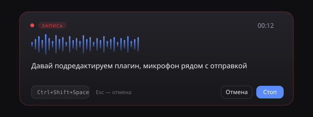

# dsh-transcribe

Голосовой ввод для [DeepSeek Harness](https://github.com/deepseek-ai/deepseek-harness): микрофон рядом с кнопкой
отправки, аккуратная панель записи с живым предпросмотром, локальное распознавание Parakeet Ultra.

Распознавание целиком локальное: без облака, без API-ключей, без телеметрии — аудио не покидает машину.
Кнопки проверки и улучшения текста используют модель, уже выбранную в DSH, и отправляют ей только
текст черновика (см. «Проверка и улучшение текста»).



## Что умеет

- **Кнопка микрофона** в панели композера, сразу слева от отправки.
- **Клик** — запись пошла: кнопка краснеет, над композером выезжает панель с уровнем сигнала и таймером.
- **Живой предпросмотр** — распознанный текст появляется в полоске панели каждые ~1,5 с.
- **Повторный клик** (или ваша горячая клавиша) — запись останавливается, финальный текст вставляется
  в поле ввода в позицию каретки.
- **Отправка в чат** — режим «В чат»: после распознавания текст вставляется и сообщение сразу уходит.
- **Две горячие клавиши** — отдельно «вставить в поле» и «отправить в чат». Обе настраиваются:
  клик по чипу в панели, затем любая комбинация (Ctrl/Alt/Shift + клавиша, или F1–F12).
- **Голосовые команды** — «стоп чат» останавливает запись и оставляет текст в поле, «отправь»
  останавливает и сразу отправляет в чат. Обе фразы настраиваются.
- **Две кнопки для текста** рядом с микрофоном: «А с галочкой» исправляет орфографию и пунктуацию,
  «палочка с блёстками» переписывает надиктованное в чёткий промпт.
- **Ключевая фраза** — включите прослушивание (иконка «волны» рядом с микрофоном), скажите
  «окей дипсик» — запись начнётся сама, а по паузе текст останется в поле ввода.
- **Esc** — отмена, ничего не вставляется.
- Если поле ввода недоступно, текст не теряется: панель предложит вставить его вручную.

## Режимы и горячие клавиши

В панели есть переключатель **«В поле» / «В чат»** — он задаёт, что делать с распознанным текстом:

| Режим | Что происходит |
|---|---|
| **В поле** | текст вставляется в черновик, вы его проверяете и отправляете сами |
| **В чат** | текст вставляется и сообщение сразу отправляется |

Горячие клавиши по умолчанию:

| Действие | Комбинация |
|---|---|
| Начать/остановить запись с вставкой в поле | `Ctrl+Shift+Space` |
| Начать/остановить запись с отправкой в чат | `Ctrl+Shift+Enter` |
| Отмена записи | `Esc` |

Обе комбинации меняются: нажмите чип `→ …` или `⏎ …` в панели и введите свою. Требуется модификатор
(Ctrl/Alt/Shift/Win) или F-клавиша. Настройки хранятся в браузере.

## Голосовые команды: стоп-слово и слово отправки

Две независимые команды, обе звучат в конце реплики:

| Команда | Что делает | По умолчанию |
|---|---|---|
| **Стоп-слово** | останавливает запись, текст до фразы остаётся в поле ввода | «стоп чат» |
| **Слово отправки** | останавливает запись и сразу отправляет текст в чат | «отправь» |

- Обе включаются и выключаются в панели: шестерёнка → галочки.
- Фразы настраиваются там же. Слова не должны совпадать.
- Срабатывают, только если фраза стоит в конце распознанного хвоста — чтобы слово внутри
  предложения не обрывало запись.
- Задержка 1,5–2,5 с: фраза ловится на очередном цикле предпросмотра. Если запись остановилась
  раньше (пауза в режиме ключевой фразы), фраза всё равно распознаётся в финальном тексте.
- Переключатель «В поле / В чат» на команды не влияет — он только для ручной остановки
  (хоткей или кнопка).

## Ключевая фраза (автодетектор)

Режим постоянного прослушивания: плагин держит микрофон открытым, пока окно DSH активно,
и ждёт ключевую фразу. Сказали «окей дипсик» — началась запись, дальше всё как обычно.

- **Включение** — иконка «волны» рядом с микрофоном. Нажали — она залилась синим, значит слушаю.
  Никаких всплывающих окон; повторное нажатие выключает. Состояние запоминается.
- **Настройки** — шестерёнка в панели записи (панель открывается кнопкой микрофона): ключевая
  фраза, пауза до остановки, стоп-слово и слово отправки. Окно настроек выезжает **над** панелью, поэтому не уходит
  за нижний край окна.
- **Фраза** настраивается, по умолчанию «окей дипсик». Сравнение нечёткое: распознавание может
  услышать «окей, ди псик» — это по-прежнему попадание.
- **Пауза до остановки** — любое значение от 0,3 до 15 с (по умолчанию 1,4), вводится числом;
  запятая и точка равнозначны. Замолчали на эту паузу — запись закончилась. Снимите галочку
  «Останавливать по паузе» (или введите 0), если думаете над формулировкой: тогда запись идёт,
  пока не скажете стоп-слово или слово отправки.
- **Фокус окна** — свернули или переключились в другое приложение, микрофон освобождается.
  Вернулись — прослушивание включается снова (кнопка остаётся синей: режим включён).
- **Команды и хоткеи** работают и в этом режиме: можно оборвать запись вручную.

Как это устроено: Parakeet не стриминговая, поэтому постоянно её гонять нельзя (20–25 % ядра).
Плагин режет поток по энергии: 70 мс голоса открывают фразу, 350 мс тишины закрывают. Только
готовый короткий кусок уходит на распознавание — в тишине процессор почти не занят.

```
микрофон → VAD по энергии → короткий сегмент → POST /dsh-transcribe/wake → есть фраза?
                                                                          │ да
                                          запись продолжается с того же места (без потери слов)

конец записи: пауза или стоп-слово → текст в поле ввода
              слово отправки       → текст сразу в чат
```

## Проверка и улучшение текста

Две кнопки рядом с микрофоном работают с текущим черновиком:

| Кнопка | Что делает | Режим |
|---|---|---|
| **А с галочкой** | исправляет орфографию, пунктуацию, грамматику | `grammar` |
| **Палочка с блёстками** | переписывает надиктованное в чёткий промпт для ИИ | `prompt` |

Обе подменяют черновик результатом и показывают плашку справа внизу на 4 секунды:
«Текст исправлен» / «Промпт улучшен» / «Без изменений» / «Не удалось: …».

- **Грамматика** не меняет смысл, порядок слов, стиль и тип предложения — утверждение не
  превращается в вопрос. Если текст уже корректен, приходит «Без изменений».
- **Промпт** убирает слова-заполнители («ну», «типа», «вот», «как бы»), делает задачу явной —
  что сделать и что считать результатом. Факты, числа, имена и требования не выдумываются:
  только то, что было сказано. Короткая просьба остаётся короткой.
- **Модель** — та, что выбрана в DSH (`agentDefaultModel`). Задать другую можно в `cordis.patch.yml`:
  `llmProvider` и `llmModel`.
- **Приватность.** Это единственное место, где текст покидает машину: он уходит провайдеру модели,
  которой вы и так пишете в чат. Аудио по-прежнему никуда не отправляется.
- **Ограничения** — до 8000 символов за раз; замена черновика не создаёт отдельного шага отмены,
  а цитаты и вложенные чипы при замене теряются.

```
черновик → POST /dsh-transcribe/fix { text, mode } → llm.stream(provider, model) → { text, changed }
```

## Требования

- Windows 10/11 x64.
- DeepSeek Harness 0.2.x (desktop или web).
- `transcribe-cli.exe` — 3,4 МБ, движок распознавания.
- Модель `parakeet-ultra-Q8_0.gguf` — 740 МБ (706 МиБ).

И то, и другое **уже вшито в установщик** `dsh-transcribe-setup-<версия>.exe` — интернет при установке
не нужен.

## Установка на новом компьютере

### Вариант 0: установщик (рекомендуется)

Скачайте `dsh-transcribe-setup-0.4.0.exe` из [релизов](https://github.com/chernogriff11-alt/dsh-transcribe/releases)
и запустите. Он распакует плагин, движок и модель в правильные места:

| Что | Куда |
|---|---|
| плагин (16 файлов) | `%LOCALAPPDATA%\dsh-transcribe` |
| движок | `%USERPROFILE%\.dsh\bin\transcribe-cli.exe` |
| модель | `%USERPROFILE%\.dsh\models\parakeet-ultra\parakeet-ultra-Q8_0.gguf` |

Уже существующие файлы не перезаписываются, если размер совпадает. Дальше — **Настройки → Плагины →
Добавить плагин** → указать `%LOCALAPPDATA%\dsh-transcribe`, перезапустить DSH и обновить страницу (F5).

Установщик не подписан, SmartScreen может предупредить; контрольные суммы — в `SHA256SUMS.txt`.
Проверить, что он сделает, без записи файлов: `dsh-transcribe-setup-0.4.0.exe --dry-run`.

### Вариант 1: скриптом

```powershell
powershell -ExecutionPolicy Bypass -File .\install.ps1
```

Скрипт скачает движок и модель в те же папки с GitHub и Hugging Face. Дальше — установить плагин
и перезапустить DSH (шаг 3–4 ниже).

### Вариант 2: вручную

1. **Движок.** Скачайте `transcribe-cli.exe` из последнего релиза и положите сюда:

   ```
   %USERPROFILE%\.dsh\bin\transcribe-cli.exe
   ```

2. **Модель.** Скачайте `parakeet-ultra-Q8_0.gguf` (или `Q4_K_M` — меньше и быстрее) и положите сюда:

   ```
   %USERPROFILE%\.dsh\models\parakeet-ultra\parakeet-ultra-Q8_0.gguf
   ```

   Прямая ссылка:
   `https://huggingface.co/handy-computer/parakeet-ultra-gguf/resolve/main/parakeet-ultra-Q8_0.gguf`

3. **Плагин.** Склонируйте репозиторий и установите его в профиль:

   ```powershell
   git clone https://github.com/chernogriff11-alt/dsh-transcribe.git
   dsh plugin --profile desktop add "C:\path\to\dsh-transcribe"
   ```

   Или в интерфейсе: **Настройки → Плагины → Добавить плагин** и укажите путь к папке.

4. **Перезапуск.** Полностью закройте DeepSeek Harness (включая иконку в трее) и откройте снова.
   Обновите страницу (F5).

5. **Проверка.** Откройте `http://127.0.0.1:<порт>/dsh-transcribe/status` — должно быть `"ready": true`.

## Движок и модель: где взять

| Что | Откуда | Размер |
|---|---|---|
| Движок `transcribe-cli.exe` | [релизы dsh-transcribe](https://github.com/chernogriff11-alt/dsh-transcribe/releases) (ассет `transcribe-cli.exe`) | 3,4 МБ |
| Движок, первоисточник | [handy-computer/transcribe.cpp](https://github.com/handy-computer/transcribe.cpp/releases) — сборка v0.4.1, MIT | 3,4 МБ |
| Модель `parakeet-ultra-Q8_0.gguf` | [handy-computer/parakeet-ultra-gguf](https://huggingface.co/handy-computer/parakeet-ultra-gguf) | 740 МБ |
| Модель `Q4_K_M` (полегче) | там же, `parakeet-ultra-Q4_K_M.gguf` | 486 МБ |
| И то, и другое | внутри `dsh-transcribe-setup-0.4.0.exe` | 744 МБ |

Прямая ссылка на модель:
`https://huggingface.co/handy-computer/parakeet-ultra-gguf/resolve/main/parakeet-ultra-Q8_0.gguf`

### Куда положить, чтобы DSH подхватил сам

Ничего настраивать не нужно, если файлы лежат здесь:

```
%USERPROFILE%\.dsh\bin\transcribe-cli.exe
%USERPROFILE%\.dsh\models\parakeet-ultra\parakeet-ultra-Q8_0.gguf
```

Плагин ищет движок и модель сам, при старте и на каждый запрос:

**Движок**, по порядку:

1. `cliPath` в настройках плагина;
2. `%USERPROFILE%\.dsh\bin\transcribe-cli.exe` ← сюда кладёт установщик;
3. `<папка плагина>\bin\transcribe-cli.exe`;
4. `transcribe-cli.exe` в `PATH`.

**Модель**, по порядку:

1. `modelPath` в настройках;
2. `%USERPROFILE%\.dsh\models\parakeet-ultra\*.gguf` ← сюда кладёт установщик (любой `.gguf` в папке,
   предпочитает Q8_0, затем Q6_K, Q5_K, Q4_K);
3. `<папка плагина>\models\*.gguf`;
4. кэш Hugging Face (`~/.cache/huggingface/hub/models--handy-computer--parakeet-ultra-gguf`).

Проверка: `http://127.0.0.1:<порт>/dsh-transcribe/status` покажет, что именно найдено и по какому пути.
Если движок или модель не найдены, плагин пишет это в панели записи, а не падает молча.

Модель — [moondream/parakeet-ultra](https://huggingface.co/moondream/parakeet-ultra), post-trained
`parakeet-tdt-0.6b-v3`: 25 европейских языков, пунктуация, заглавные, таймкоды, встроенный VAD.
Лицензия **CC-BY-4.0** — при распространении указывайте автора.

## Настройка

`cordis.patch.yml` в папке плагина:

```yaml
- insert:
    - id: dsh-transcribe
      name: 'dsh-transcribe'
      config:
        language: ''          # пусто — язык определяется сам; или подсказка: ru, en, de…
        timeoutMs: 180000     # таймаут одного распознавания
        # cliPath: 'D:\tools\transcribe-cli.exe'
        # modelPath: 'D:\models\parakeet-ultra-Q8_0.gguf'
        # llmProvider: 'polza'     # модель для проверки текста; по умолчанию — выбранная в DSH
        # llmModel: 'deepseek/deepseek-v4.1-flash-1017@provider=morph/fp8&allow_fallbacks=true'
```

После правки конфига перезапустите DSH.

## Как это работает

```
браузер: микрофон → AudioWorklet → PCM16 16 кГц
   │
   ├─ каждые 1,5 с: последние 10 с → POST /dsh-transcribe/partial → текст в полоску
   └─ стоп: весь буфер → POST /dsh-transcribe/transcribe → финальный текст → в поле ввода
                                   │
                          WAV → transcribe-cli.exe → текст
```

Модель не стриминговая, поэтому предпросмотр — это повторное распознавание хвоста записи.
Финальный текст всегда считается по всему буферу и точнее предпросмотра.

## Ограничения

- Только Windows: движок поставляется как `.exe`.
- Диаризации (кто говорил) нет.
- Предпросмотр может «дёргаться» на границах фраз — это нормально.
- При первом запуске Windows спросит доступ к микрофону.
- Микрофон работает только на `localhost` или по HTTPS (требование браузера).
- Ключевая фраза должна звучать **в начале** реплики: «окей дипсик, открой настройки» — да,
  «слушай, окей дипсик» — нет. Одно-два слова перед фразой допускаются.
- В шумном помещении порог подстраивается под фон за 15–20 с; пока не подстроился, фраза
  может не ловиться. Громкая музыка или телевизор рядом снижают чувствительность.
- Пока прослушивание включено, Windows показывает, что микрофон занят, — это ожидаемо.

## Проверка без микрофона

```powershell
# синтез речи голосом Windows -> маршрут плагина, печатает текст, hit и тайминги
.\tools\wake-probe.ps1 -Text "окей дипсик" -Route wake
.\tools\wake-probe.ps1 -Text "привет как дела" -Route wake

# нарезка речи, вырезание фразы, дымовой рендер клиента
node tools\test-wake-engine.mjs
node tools\test-wake-match.mjs
node tools\test-client-render.mjs
node tools\test-rewrite-button.mjs
```

`wake-probe.ps1` сохранять в UTF-8 **с BOM**: PowerShell 5.1 иначе читает кириллицу как cp1251.

## Лицензия

Код плагина — MIT. Движок [transcribe.cpp](https://github.com/handy-computer/transcribe.cpp) — MIT.
Модель — CC-BY-4.0, автор [moondream](https://huggingface.co/moondream/parakeet-ultra).
